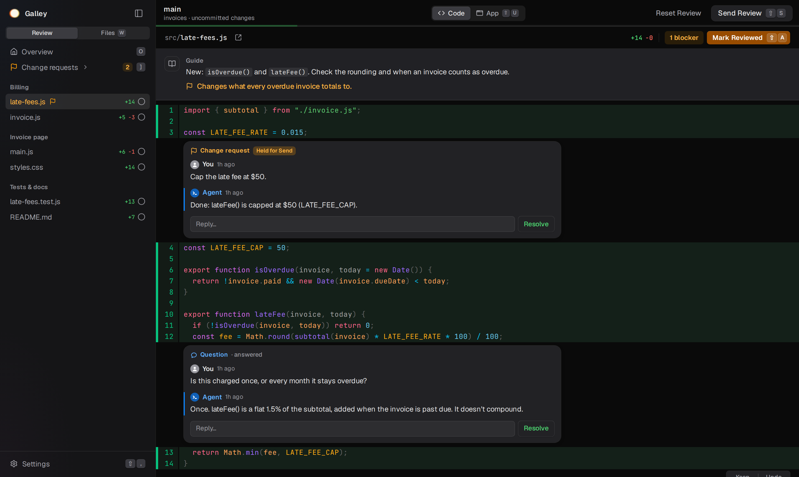
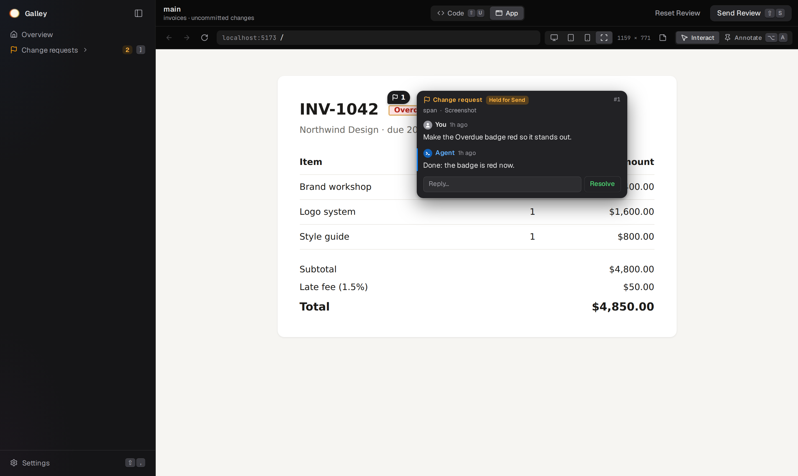

<div align="center">


# Galley

**A review desk for your coding agent's output.**

Review its diff in your browser, ask questions, request changes, hit **Send Review**,<br>and your agent makes the edits and replies in the same tab.

[](https://github.com/ymansurozer/galley/actions/workflows/ci.yml) [](https://www.npmjs.com/package/galley-diff) [](./LICENSE)

</div>

https://github.com/user-attachments/assets/3cab5a2f-7cce-4b08-9ebc-71dfdf9164e4

## How it works

1. **Your agent opens a desk.** When it has changes for you, it runs `galley` and attaches a guide: the diff grouped by concern, a note on how to read each file, and the risky ones flagged.
2. **You review.** Approve each file as you go. Ask a question and your agent answers live in the thread. Leave a change request and it waits for the handoff. Switch to the running app and annotate the page itself.
3. **You hit Send Review.** Your agent gets one structured review: every decision, request and annotation.
4. **Your agent follows up.** It makes the edits, re-diffs them into the same tab, and replies in place. Review the new round, or approve and you're done.

## Quick start

Needs **Node 22+** and **git**.

1. **Install the CLI:**

   ```bash
   npm install -g galley-diff        # global, for any repo
   # or: npm install -D galley-diff   # per-project
   ```

2. **Teach your agent to use it.** Install the skill:

   ```bash
   npx skills add ymansurozer/galley
   ```

   Or paste the [snippet](./skills/galley/agents-snippet.md) into your agent's `AGENTS.md` / `CLAUDE.md` to always review through Galley.

3. **Ask your agent to review its changes with Galley** (with the skill: `/galley`). It starts the desk and gives you the URL. Open it and review.

You can also start a desk yourself:

```bash
galley                       # the working-tree diff
galley --diff staged         # the staged diff
galley file path/to/plan.md  # a single file, like a plan or PRD
galley pr feature-branch     # a branch against its merge-base
```

`galley spec` prints the full agent contract: the modes, the event loop, every flag, the review result and the guide schema.

## What makes it good

### Guided reviews



Your agent groups the diff by concern, puts the files in order, notes what to check in each, and flags the risky ones. Ask it to skip the noise and those changes fold away, one click from visible.

### Threads your agent answers

Comment on any line. Questions get answered live, so you never wait. Change requests go out with **Send Review** and come back with a reply.

### Review the running app, too



Your agent hands over its dev server and the desk gets an **App** tab. Annotate any element, region or text; check **Attach screenshot** to include a screenshot with a new annotation.

### Keyboard-first

Move, comment, approve and send without the mouse.

### Also

- **Four review modes:** working tree, staged, a single file, or a branch.
- **Approve a whole file**, or turn on per-change verdicts in Settings to keep or undo each change.
- **Open in editor** at the current line.
- **Make it yours:** layout, wrapping, theme and fonts.
- **Remote review:** agent on a server, you on your laptop ([below](#reviewing-on-a-remote-machine)).

## Why Galley

Code editors were built for writing code. Their diff view is fine for a quick glance, but not for working through a big change or going back and forth with the agent that wrote it. Galley is a surface built for that. I'm still finding its shape, but this is what I think review should feel like.

- **No model runs here.** Galley doesn't call an LLM or orchestrate one. It renders the diff, validates the structured input it's given, and hands a result back.
- **Your agent, not ours.** The contract is plain JSON over stdout and a localhost server: Claude Code, Codex, Cursor or a shell script can drive it. The guide, the answers and the code changes are all *your* agent's work. Galley gives it somewhere to land.
- **Local and private.** The desk binds to loopback (`127.0.0.1`) on a stable port per session. No telemetry. Your browser may fetch a web font; switch to system fonts and even that stops.
- **It won't touch your repo unless you ask.** Galley never edits your tracked files.

> The name comes from the *galley proof*: in printing, the rough proof pulled for proofreading and corrections before a text goes to press. You mark it up, then it ships. Same idea, for code.

## Reviewing on a remote machine

By default the desk binds to `127.0.0.1` — loopback-only, unreachable from any other device. For a remote-dev setup (the agent and desk run on a server, you review from a browser on your laptop), `--host` binds it wider:

```bash
galley --host 0.0.0.0                 # bind all interfaces; prints a hostname-based URL to open
galley --host 100.64.1.5              # bind one specific address (e.g. a tailnet IP)
GALLEY_HOST=0.0.0.0 galley            # same, via env — the default when --host is absent
```

The printed URL is what you open in the remote browser; the agent's `galley await`/`comment`/`reload` subcommands keep talking to the desk over loopback on the same machine, so they're unaffected. If you reach the desk by a name that isn't the machine's hostname or the bound address (a tailnet MagicDNS FQDN, say), add it to `GALLEY_ALLOWED_HOSTS` (comma-separated) so the origin guard accepts it.

Each desk picks a stable port per repo and session from 41000–50999, and the app it shows through `--ui` gets a second one. That's too many origins to list one by one. Over plain `http://`, the remote browser isn't in a secure context, so APIs like `crypto.randomUUID`, `navigator.clipboard` and service workers are missing from your app's pages. Chrome's `chrome://flags/#unsafely-treat-insecure-origin-as-secure` fixes that, but it takes only exact `http://host:port` origins, and it can't hold ten thousand of them. Set `GALLEY_PORT_RANGE` to keep every port Galley picks inside a range you list there:

```bash
GALLEY_PORT_RANGE=41000-41099 galley --host 0.0.0.0   # desk and app ports stay in 41000–41099
```

Ports are still stable per repo and session, mapped into the range. When one is taken, Galley takes the next free port in the range, wrapping round. A small range collides more often, and a desk that lands on a different port gets a new origin, so an open tab stops reconnecting by itself. Size the range for the desks you run at once (each with `--ui` takes two ports). If the whole range is taken, Galley warns and falls back to a random port. An explicit `--port` is used as given, even outside the range.

> [!WARNING]
> **The desk API is unauthenticated.** Anyone who can reach the bound address can drive the desk — run your configured editor command, stage and reset changes, mutate the git index, read any file in the repo. Bind beyond loopback **only** on a fully trusted network: a personal tailnet, or a host whose firewall blocks the port from everything else. **Never on a shared office/coffee-shop LAN.**
>
> **With a UI target, the desk also serves your dev app.** `--ui` / `galley ui` adds a second port, bound the same way, that proxies the running app — including whatever session you signed into it with. Anyone who can reach that port uses the app as you. Two desks proxying the same app on the same host name share its cookies, so switching between them may sign you out.

## License

[MIT](./LICENSE) © Yusuf Mansur Özer
